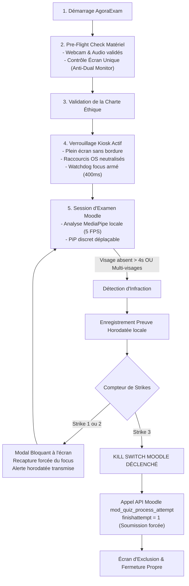

# AgoraExam

**Navigateur d'examen sécurisé (Lockdown Browser) et télésurveillance éthique pour Moodle**  
*Confinement Kiosk matériel • Inférence faciale 100% locale (Edge AI) • Zero-Cloud Video • Conforme RGPD*

[](https://github.com/fadelilyas01/AgoraExam/releases)
[](https://tauri.app/)
[](https://github.com/fadelilyas01/AgoraExam)
[](LICENSE)

---

## Sommaire exécutif

| Caractéristique | Spécification AgoraExam |
| :--- | :--- |
| **Objectif** | Élimination de la triche en ligne lors des partiels et devoirs sur Moodle sans intrusion dans la vie privée. |
| **Poids du client** | **~20,7 Mo** (vs ~160 Mo pour Respondus ou Safe Exam Browser). |
| **Inférence IA** | **100% sur l'ordinateur de l'étudiant** (MediaPipe WebAssembly). Aucun flux vidéo n'est diffusé sur internet. |
| **Sécurité système** | Confinement plein écran forcé, masquage de barre des tâches, blocage clavier en phase de capture, watchdog Rust 400ms. |
| **Intégration LMS** | Compatible nativement avec **Moodle 3.9+, 4.x et 5.x** via l'API Web Services REST scellée. |
| **Politique d'exclusion** | Règle des 3 avertissements avec filtre anti-faux positifs de 4s et **Kill Switch Moodle** immédiat. |

---

## Matrice comparative des solutions de télésurveillance

| Fonctionnalité | AgoraExam | Respondus LockDown Browser | Safe Exam Browser (SEB) | Proctorio / TestWe |
| :--- | :---: | :---: | :---: | :---: |
| **Modèle économique** | **Open-source (MIT)** | Propriétaire / Payant | Open-source | Propriétaire / Coûteux |
| **Analyse faciale de présence** | **Intégrée en local (Edge AI)** | Non (nécessite Monitor payant) | Non | Enregistrement Cloud invasif |
| **Respect de la vie privée (RGPD)** | **Zéro streaming cloud** | Vidéos hébergées sur serveurs tiers | N/A | Analyse faciale déportée |
| **Filtre anti-faux positifs** | **Tolérance active de 4s** | Faux positifs fréquents | N/A | Alertes arbitraires |
| **Kill Switch Moodle automatique** | **Oui (`finishattempt=1`)** | Non (manuel par enseignant) | Non | Non |
| **Preuves horodatées d'infraction** | **Captures chiffrées locales** | Vidéos complètes stockées | Aucune preuve visuelle | Vidéos complètes stockées |
| **Empreinte mémoire et CPU** | **Faible (~85 Mo RAM)** | Élevée (> 300 Mo RAM) | Moyenne | Très élevée |

---

## Téléchargement des versions officielles

Les installateurs officiels prêts au déploiement pour vos sessions d'examens :

| Système | Format | Téléchargement direct | Architecture | Statut |
| :--- | :---: | :---: | :---: | :---: |
| **Windows** | `.exe` | [Télécharger AgoraExam.exe](https://github.com/fadelilyas01/AgoraExam/releases/latest/download/AgoraExam.exe) | x64 (Windows 10 & 11) | Production |
| **macOS Apple Silicon** | `.dmg` | [Télécharger AgoraExam-aarch64.dmg](https://github.com/fadelilyas01/AgoraExam/releases/latest/download/AgoraExam-aarch64.dmg) | Apple M1, M2, M3, M4 | Production |
| **macOS Intel** | `.dmg` | [Télécharger AgoraExam-x64.dmg](https://github.com/fadelilyas01/AgoraExam/releases/latest/download/AgoraExam-x64.dmg) | Intel Core (macOS 10.15+) | Production |
| **Linux Universitaire** | `.AppImage` | [Télécharger AgoraExam.AppImage](https://github.com/fadelilyas01/AgoraExam/releases/latest/download/AgoraExam.AppImage) | GLIBC 2.31+ | Production |

> [!TIP]
> **Accès immédiat sans téléchargement web :**  
> L'exécutable autonome Windows a déjà été compilé dans votre espace de travail :  
> `C:\Projet\AgoraExam\release-bin\AgoraExam.exe` (Prêt à être distribué sur clé USB ou réseau de campus).

---

## Cycle de vie de l'examen et protocole de surveillance



---

## Précautions de sécurité et rigueur d'ingénierie

Pour répondre aux exigences strictes de sécurité institutionnelle, AgoraExam intègre plusieurs couches défensives de niveau industriel :

### 1. Confinement Kiosk et neutralisation des raccourcis OS
- **Capture-Phase Keyboard Trap :** Les raccourcis système (`Alt+Tab`, `Alt+F4`, `Ctrl+W`, `Ctrl+N`, `Ctrl+T`, `Ctrl+Shift+I`, `F1` à `F12`) sont interceptés dès la phase de capture du DOM et annulés (`preventDefault()`, `stopPropagation()`).
- **Watchdog asynchrone Rust :** Une tâche Tokio scrute l'état de la fenêtre d'examen toutes les 400ms. Si la fenêtre perd le focus ou tente d'être minimisée, Rust impose immédiatement la restauration au premier plan (`unminimize`, `set_always_on_top(true)`, `set_focus()`).
- **Suppression de la barre des tâches :** La propriété native `skipTaskbar: true` désactive l'accès aux fenêtres tierces via le gestionnaire de bureau de l'OS.
- **Interdiction du menu contextuel :** Le clic droit et l'inspection de code sont intégralement verrouillés.

### 2. Confidentialité par conception (Privacy by Design & RGPD)
- **Zero-Cloud Video Streaming :** L'inférence neuronale des 468 points de repère du visage est exécutée par le CPU/GPU local dans le conteneur WebAssembly de MediaPipe. Le flux de la webcam ne quitte jamais la mémoire vive de l'ordinateur.
- **Preuves proportionnées et auditables :** Seules des captures ponctuelles au moment exact d'un avertissement validé sont archivées localement avec empreinte horodatée pour servir de pièce lors des commissions disciplinaires.
- **Effacement cryptographique en RAM (Zeroize) :** Les jetons de session Moodle et informations sensibles sont écrasés par des zéros en mémoire vive dès leur libération (`zeroize::ZeroizeOnDrop`).
- **Communications chiffrées 100% Rust :** La pile réseau utilise `reqwest` avec le moteur TLS natif `rustls` (crypto `ring`), bannissant les bibliothèques OpenSSL sujettes aux vulnérabilités mémoire en C.

### 3. Contrôle matériel strict (Anti-Dual Monitor)
- Interrogation directe du gestionnaire d'affichage de l'OS avant le démarrage.
- En cas de détection d'un second moniteur (HDMI, DisplayPort, USB-C vidéo, AirPlay ou écran dupliqué), le bouton de démarrage de l'examen reste strictement désactivé jusqu'au débranchement physique de l'écran secondaire.

---

## Guide d'intégration enseignant pour Moodle

La mise en place de la restriction d'accès ne requiert **aucun plugin serveur tiers** :

### 1. Configuration du Quiz sur Moodle
1. Accédez aux **Paramètres du Test** sur votre espace Moodle.
2. Dans la section **Restrictions supplémentaires sur les tentatives**, définissez une clé d'accès robuste (ex: `AgoraSession_2026_SecureKey`).
3. **Conservez cette clé secrète** (ne la communiquez jamais aux étudiants).

### 2. Insertion du bloc d'accès sécurisé
Collez ce bloc HTML dans la description de votre test sur Moodle :

```html
<div style="border: 1px solid #334155; border-radius: 8px; padding: 18px; background: #0f172a; color: #f8fafc; text-align: center; max-width: 580px; margin: 0 auto; font-family: sans-serif;">
  <h3 style="margin-top: 0; color: #38bdf8; font-size: 16px;">Examen Télésurveillé Obligatoire</h3>
  <p style="font-size: 13px; color: #94a3b8; line-height: 1.5; margin-bottom: 16px;">
    Cet examen applique la politique de surveillance AgoraExam. L'accès depuis un navigateur web standard est verrouillé.
  </p>
  <a href="agoraexam://launch?quizid=142&attempt=new" 
     style="display: inline-block; background: #0ea5e9; color: #ffffff; text-decoration: none; font-weight: 600; font-size: 13px; padding: 10px 20px; border-radius: 6px;">
    Démarrer l'examen dans AgoraExam
  </a>
  <div style="margin-top: 14px; padding-top: 12px; border-top: 1px solid #1e293b; font-size: 11px; color: #64748b;">
    Application non installée ? 
    <a href="https://github.com/fadelilyas01/AgoraExam/releases/latest/download/AgoraExam.exe" style="color: #38bdf8; text-decoration: underline;">
      Télécharger AgoraExam pour Windows
    </a>
  </div>
</div>
```

---

## Architecture logicielle

```text
AgoraExam/
├── release-bin/                          # Binaire autonome de distribution immédiate
│   └── AgoraExam.exe                     # Exécutable natif Windows (~20.7 Mo)
│
├── src/                                  # Couche de présentation & Vision locale
│   ├── components/
│   │   └── PreFlightCheck.tsx            # Diagnostic webcam, audio, mono-écran et conformité
│   ├── services/
│   │   └── faceDetection.ts              # Pipeline MediaPipe Wasm (présence & multi-visages)
│   ├── App.tsx                           # Kiosk HUD, moniteur PiP déplaçable, pièges clavier/focus
│   └── index.css                         # Design tokens sémantiques conformes aux règles UI/UX
│
└── src-tauri/                            # Couche système native en Rust (Tauri v2)
    ├── Cargo.toml                        # Dépendances système (reqwest rustls, zeroize, tokio)
    ├── tauri.conf.json                   # Configuration Kiosk, exclusion taskbar, autorisations OS
    ├── Info.plist                        # Déclarations des autorisations matérielles macOS
    └── src/
        ├── lib.rs                        # Watchdog de focus, interception fermeture, API Moodle
        └── main.rs                       # Point d'entrée binaire et initialisation tracing
```

---

## Déploiement Web Universel (Vercel, Netlify & GitHub Pages)

Le portail web officiel et la documentation d'AgoraExam sont optimisés pour un déploiement instantané à zéro coût sur n'importe quel hébergeur moderne :

| Plateforme | Type de déploiement | Fichier de configuration | Déploiement 1-Clic |
| :--- | :--- | :--- | :---: |
| **Vercel** | Edge Network mondial (Vite) | [`vercel.json`](vercel.json) | [](https://vercel.com/new/clone?repository-url=https%3A%2F%2Fgithub.com%2Ffadelilyas01%2FAgoraExam) |
| **Netlify** | CDN mondial & SPA redirects | [`netlify.toml`](netlify.toml) | [](https://app.netlify.com/start/deploy?repository=https://github.com/fadelilyas01/AgoraExam) |
| **GitHub Pages** | Workflow GitHub Actions | [`.github/workflows/deploy-pages.yml`](.github/workflows/deploy-pages.yml) | Automatique sur push `main` |

### Déploiement sur Vercel (En 30 secondes)
1. Rendez-vous sur [vercel.com](https://vercel.com) et connectez-vous avec votre compte GitHub.
2. Cliquez sur **« Add New... »** > **« Project »**.
3. Importez le dépôt **`fadelilyas01/AgoraExam`**.
4. Vercel détecte automatiquement `vercel.json` (Framework: *Vite*, Build: `npm run build`, Output: `dist`).
5. Cliquez sur **« Deploy »** : le site est instantanément en ligne avec certificat SSL et CDN haute performance.

### Déploiement sur Netlify (En 30 secondes)
1. Rendez-vous sur [app.netlify.com](https://app.netlify.com) et connectez-vous avec votre compte GitHub.
2. Cliquez sur **« Add new site »** > **« Import an existing project »** > **GitHub**.
3. Sélectionnez le dépôt **`fadelilyas01/AgoraExam`**.
4. Netlify applique automatiquement la configuration de `netlify.toml` (Build: `npm run build`, Publish: `dist`, Redirects: `/* -> /index.html`).
5. Cliquez sur **« Deploy AgoraExam »**.

### Déploiement via le Terminal (CLI)
```bash
# Déploiement direct en production sur Vercel :
npx vercel --prod

# Déploiement direct en production sur Netlify :
npx netlify deploy --prod --dir=dist
```

---

## Instructions de compilation locale

### Prérequis de compilation
- **Node.js** (v20 ou supérieur)
- **Rust & Cargo** (v1.80 ou supérieur) avec la toolchain `stable-x86_64-pc-windows-msvc`
- **Visual Studio Build Tools** (Charge de travail C++ et Windows 10/11 SDK)

### Commandes de développement
```bash
# 1. Cloner le référentiel
git clone https://github.com/fadelilyas01/AgoraExam.git
cd AgoraExam

# 2. Installer les dépendances
npm install

# 3. Lancer l'application de bureau en mode Kiosk natif
npm run tauri dev
```

---

## Licence

Ce logiciel est distribué sous licence open-source **MIT**. Consulter le fichier [LICENSE](LICENSE) pour plus d'informations.
